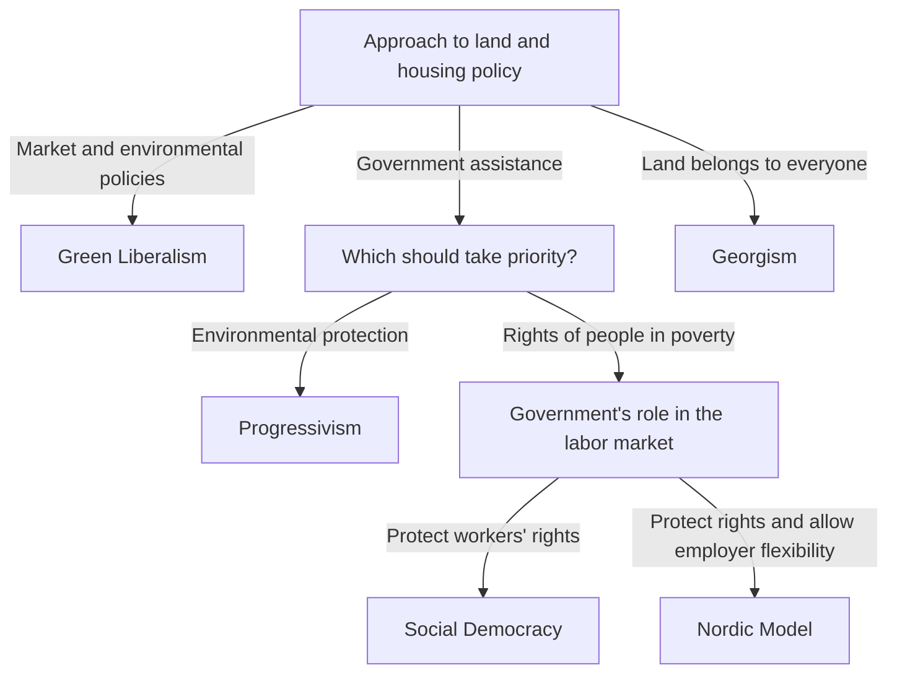

> [!IMPORTANT]
> **None of the questions, answer options, or results on this website represent the author's personal political views or endorsement of any ideology.** They are included solely because studying and exploring these topics requires examining a range of political ideas and viewpoints.

# Ideology Test — Where You Stand?

A bilingual web project that explores political ideas through an explicit, branching questionnaire. Each answer determines the next question, leading to one of 105 named results.

The project brings together political concepts, decision-tree modeling, interface design, and Chinese–English localization. Questions cover the role of government, economic inequality, ownership, public welfare, tradition, globalization, and individual freedom. The classification rules are available in the source code and in two accompanying logic maps, so readers can examine how a result is reached.

| Current scope | |
| --- | --- |
| Question nodes | 87 across the full tree |
| Answer choices | 191 across those nodes |
| Possible results | 105, presented as text |
| Questions per completed attempt | 4–9, depending on the chosen path |
| Main-site languages | English and Simplified Chinese |
| Implementation | HTML, CSS, vanilla JavaScript; optional Node.js feedback server |

These counts describe the current `logical.js` implementation. A visitor follows one branch rather than answering all 87 questions.

## Run locally

Clone the repository and start the included server with Node.js:

```sh
git clone https://github.com/Lmx1217/Ideology_Test.git
cd Ideology_Test
node server.cjs
```

Open the [English homepage](http://127.0.0.1:3000/?lang=en) or the [Chinese homepage](http://127.0.0.1:3000/?lang=zh). There are no npm packages to install and no build step. The server and tests were verified with Node.js v24.14.1.

For the quiz alone, opening `index.html` directly in a modern browser also works. The quiz can be served as a static website; submitting feedback requires the included server. If port 3000 is occupied, set `PORT` to another port before starting it.

## What the site includes

- **Branching questions:** later questions depend on earlier answers, with Back and restart controls for exploring other choices.
- **Bilingual quiz and supporting pages:** English and Chinese text for the homepage, questions, answers, results, guidance, version history, and feedback dialogs.
- **Responsive presentation:** layouts adapt to smaller screens, and an animated day/night switch changes the theme. The initial theme follows the system preference.
- **Feedback:** the homepage dialog accepts problems and suggestions, while the result-page dialog accepts result feedback. Both share input validation, submission status messages, and local file storage.
- **Supporting material:** a guide to taking the quiz, a version history, and English and Chinese XMind logic maps.
- **A separate Snake game:** a Canvas-based game with keyboard and on-screen controls, scoring, and optional boundary collisions. Its current interface is in English.

## How the decision tree works

[`logical.js`](logical.js) stores both questions and results in one keyed object. A question contains its text, an `options` map, and a `next` map connecting each option to another node. A terminal node contains a result label.

[`script.js`](script.js) starts at `initial`, renders the current question, and immediately follows the selected option's destination. The same sequence of answers always produces the same result. Classification uses these authored rules; it does not calculate a numerical ideology score or use a trained model.

For example, the following fragment appears after the user has followed the branch toward private ownership of the means of production. Labels are shortened here for readability:



This structure makes individual branches easy to inspect and revise. It also makes early choices consequential: they determine which later distinctions a user encounters. The diagram describes this project's classification rules, rather than universal definitions of the named ideologies.

Explore the full [English logic map](logic%20map%20English.xmind) or [Chinese logic map](logic%20map%20Chinese.xmind) in XMind. The executable source of truth is `logical.js`; the maps are separate files maintained alongside it.

## Engineering details

### Localization that preserves question context

The question graph is shared by both languages. [`approved-translations.js`](approved-translations.js) contains 410 Chinese-source/English-translation pairs, while [`i18n.js`](i18n.js) connects them to specific questions, options, results, and interface elements through stable IDs.

Translation reuse depends on context. For example, “No” and “No / No preference” remain distinct, and identical Chinese phrases can have different English wording in different questions. The renderer checks that the Chinese source still matches the reviewed source before applying an English translation. Changed or unrecognized text falls back to the original, making outdated translations visible instead of silently reusing them.

An explicit `?lang=en` or `?lang=zh` parameter takes precedence over the saved browser preference. English is the default when neither is available. Language links continue to work when browser storage is unavailable.

### A companion translation-review tool

[`translation-review/`](translation-review/) contains a separate browser tool for comparing Chinese text with proposed English wording. It supports pending, changes-needed, and approved states; alternative translations; editable drafts; comments; and JSON backup/import.

Stable IDs and source snapshots preserve the relationship between a review and the text it assessed. Editing a translation or changing its source reopens review while retaining previous drafts and comments. Duplicate entries can reference an existing review, and archived batches remain in the source without appearing in the active review pages.

Open `translation-review/index.html` directly, or visit [the review tool](http://127.0.0.1:3000/translation-review/) while the server is running. Records are stored in that browser, and downloaded backups can be transferred between browsers. Edits in this tool do not automatically change the public quiz; selected translations must be applied to the production files.

### Local feedback and data handling

Quiz navigation runs in the browser, and the current path is held in memory. Reloading starts a new attempt. The main site stores its language preference locally.

The optional [`server.cjs`](server.cjs) uses Node.js built-in modules to serve the site and accept `POST /api/feedback`. The homepage and result-page dialogs share [`feedback.js`](feedback.js) and [`feedback.css`](feedback.css). They send only the entered feedback text, up to 5,000 characters. Each submission becomes a UTF-8 `.txt` file in `feedback/` on the machine running the server. That directory is excluded from public file serving, and submission files are ignored by Git.

The server binds to `127.0.0.1`, validates host and origin headers, limits request size, and checks resolved file paths before serving them. It is configured for local use; a public feedback deployment would require separate hosting and server configuration.

## Repository guide

| File or directory | Role |
| --- | --- |
| [`index.html`](index.html), [`portalscript.js`](portalscript.js) | Homepage, language switch, navigation, and version display |
| [`test.html`](test.html), [`script.js`](script.js), [`logical.js`](logical.js) | Quiz interface, navigation state, and decision tree |
| [`approved-translations.js`](approved-translations.js), [`i18n.js`](i18n.js) | Reviewed bilingual text and context-specific rendering |
| [`feedback.js`](feedback.js), [`feedback.css`](feedback.css), [`server.cjs`](server.cjs) | Shared feedback dialogs and local storage endpoint |
| [`note.html`](note.html), [`history.html`](history.html) | Quiz guidance and release history |
| Root CSS files and [`daynight/`](daynight/) | Page layouts, transitions, and themes |
| [`translation-review/`](translation-review/) | Translation review, persistence, export/import, and its tests |
| [`games/snake/`](games/snake/) | Standalone Canvas game |
| [`i18n.test.cjs`](i18n.test.cjs) | Main-site localization and route regression tests |
| `logic map English.xmind`, `logic map Chinese.xmind` | Visual documentation of the branches |

## Verification

Run the main-site checks:

```sh
node --test i18n.test.cjs
```

They check language selection, English routes and result labels, preservation of the original Chinese, context-specific answer reuse, changed-source fallback, and separation of translations from branch logic.

Run the companion review-tool checks separately:

```sh
node --test translation-review/review.test.cjs
```

**Verification snapshot — October 15, 2026:** all 12 main-site tests passed. The review-tool suite passed 16 of 23 tests; seven source-consistency checks failed because review data still contains the older Chinese result prefix `你的意识形态是：`, while the current quiz uses `结果：`. Those review records need reconciliation with the updated production wording.

A traversal of the current graph also confirmed that all 192 nodes are reachable from `initial`, every answer has a valid destination, and there are no cycles. These checks establish structural consistency, not the accuracy of political classification.

## Development history

The [in-app version history](history.html) records the project's development in stages:

| Period | Documented milestone |
| --- | --- |
| May–June 2024 | Early interface, initial results, broader branches, restart/back controls, and responsive adjustments |
| July 2024 | Original 103-result milestone, homepage and guidance updates, themes, mini-game, then two additional results |
| October 2026 | English localization, translation-review workflow, local result feedback, and simplified result headings |

The current version is **1.7.3a**. This release removes quiz loading delays, adds context for follow-up questions, introduces bilingual language-switcher labels, and improves hover feedback and animation speed.

## Result presentation

Current result pages display text only. Earlier versions included third-party illustrations sourced from multiple ball-themed wikis; those illustrations have been removed from the current project files. They were not created by the author of this project. Earlier Git commits still contain the original assets.

## Scope and current limitations

This is an exploratory project for engaging with political ideas. A short decision tree simplifies complex and sometimes overlapping beliefs, and its results reflect the assumptions built into its questions and branches. No empirical validation of classification accuracy is included in the repository. The result set also contains fictional and internet-community labels alongside historical and contemporary political traditions; inclusion is not an endorsement.

Some supporting text still refers to the earlier total of 103 results, while the current code contains 105. Feedback submissions from both the homepage and result page require the local server.

Suggestions about wording, branching, translations, or software behavior are welcome through [GitHub Issues](https://github.com/Lmx1217/Ideology_Test/issues). Including the language and answer sequence makes an issue easier to reproduce.
